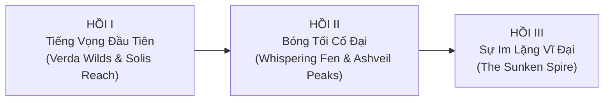

# 📖 Story Bible — Echoes of the Lost

> **Thể loại:** Action-Adventure / Archaeological Exploration RPG  
> **Bối cảnh:** Lục địa **Aethara** — 1.000 năm sau Sự Sụp Đổ (*The Great Silence*) của nền văn minh cổ đại **Solenne**  
> **Tông màu câu chuyện:** Bí ẩn cổ vật, kỳ vĩ, khám phá xen lẫn xung đột ý thức hệ giữa 3 phe phái

---

## 1. Premise (Tóm Tắt 1 Câu)

Một nhà khảo cổ học trẻ tuổi mang khả năng hiếm hoi nghe được **"Tiếng Vọng" (Echoes)** từ các tinh thể ký ức Solenne phải dấn thân qua 5 vùng đất của lục địa Aethara để giải mã nguyên nhân thật sự của *The Great Silence* trước khi phe **Void Seekers** kích hoạt lại cỗ máy tái cấu trúc thực tại cổ đại.

---

## 2. Nhân Vật Chính & Tuyến Nhân Vật

### 2.1. Protagonist — **Kaelen Vey** (The Listener)
- **Vai trò:** Học giả thực địa độc lập, từng học tại Học viện Solis thuộc *The Accord*.
- **Khả năng đặc biệt:** **Resonance Sight (Thính Giác Cộng Hưởng)** — có thể chạm vào các *Echo Crystals* và *Memory Obelisks* để nhìn/nghe lại mảnh ký ức của người Solenne từ 1.000 năm trước, đồng thời kích hoạt cơ chế cổ đại.
- **Động lực ban đầu:** Tìm kiếm người thầy mất tích — **Archivist Orin** — người đã để lại một la bàn cổ vật chỉ về vùng *Verda Wilds*.
- **Character Arc:** Từ một người chỉ muốn tìm hiểu lịch sử thuần túy trở thành người phải đưa ra phán quyết cuối cùng: trao tri thức Solenne cho *The Accord*, để *Void Seekers* tái sinh năng lượng cổ, hay cùng *The Drifters* hủy bỏ vĩnh viễn lõi *Aether Core*.

### 2.2. Antagonist — **High Cantor Malakor** (Thủ lĩnh Void Seekers)
- **Hệ tư tưởng:** Tin rằng thế giới hiện tại chỉ là "tàn tích lỗi" sau khi người Solenne tự phong ấn *Aether Core*. Malakor muốn mở khóa **The Sunken Spire** để hợp nhất ý thức nhân loại vào mạng lưới vĩnh cửu của Solenne, bất chấp việc điều đó sẽ xóa sổ sinh quyển tự nhiên của Aethara.
- **Phương pháp:** Chiếm đóng các phế tích, tái lập trình các *Sentinel Golems* và săn lùng những người có khả năng Resonance.

### 2.3. Supporting Cast (NPC Trọng Tâm)

| Nhân vật | Phe phái | Khu vực | Vai trò trong cốt truyện |
|---|---|---|---|
| **Elder Maren** | The Drifters | Verda Wilds | Người dẫn đường đầu tiên tại tiền đồn tàn tích Verda; hiểu rõ ngôn ngữ ký hiệu Solenne sơ cấp. |
| **Magistrate Lyra Vance** | The Accord | Solis Reach | Chỉ huy học thuật của The Accord; hỗ trợ tài nguyên nhưng luôn đòi hỏi quyền kiểm soát cổ vật. |
| **Archivist Orin** | Độc lập | Khắp Aethara | Người thầy mất tích của Kaelen; để lại chuỗi nhật ký giải mã sự thật về Hội đồng Solenne. |
| **Korrath the Ironhand** | The Drifters | Ashveil Peaks | Thợ rèn cổ vật bậc thầy; chế tạo và nâng cấp vũ khí cộng hưởng Aether. |
| **Vespera** | Void Seekers (Ly khai) | Whispering Fen | Cựu chỉ huy của Malakor; cung cấp thông tin nội bộ và nhiệm vụ đạo đức hai chiều. |

---

## 3. Cấu Trúc 3 Hồi (3-Act Structure)

### Hồi I — Tiếng Vọng Đầu Tiên (*Awakening the Echoes*)
- Kaelen đặt chân đến **Verda Wilds**, gặp **Elder Maren**, giải mã 2 *Echo Crystals* đầu tiên và đánh bại các *Overgrown Guardians* đang thức giấc.
- Phát hiện thông điệp của **Archivist Orin** cảnh báo rằng *The Great Silence* không phải thiên tai, mà là một **cơ chế tự ngắt khẩn cấp** do chính kiến trúc sư trưởng của Solenne kích hoạt.

### Hồi II — Bóng Tối Cổ Đại (*Fractured Alliances*)
- Hành trình qua **Solis Reach**, **Whispering Fen**, và **Ashveil Peaks** để thu thập **3 Kunci Tinh Thể (Triad Resonators)** trước khi **Void Seekers** chiếm đoạt.
- Người chơi thực hiện các nhiệm vụ phe phái (*The Accord*, *Void Seekers*, *The Drifters*), làm thay đổi điểm **Reputation (-100 đến +100)**, mở khóa kỹ năng nhánh *Combat / Exploration / Lore* và thay đổi thái độ của các thị trấn.

### Hồi III — Sự Im Lặng Vĩ Đại (*The Sunken Spire*)
- Tiến vào vùng lõi **The Sunken Spire** giữa tâm chấn cổ đại.
- Đối đầu **High Cantor Malakor** và **The Prime Architect Automaton**.
- **3 Ending dựa trên Reputation & Lựa chọn cuối:**
  1. **Ending A — Pax Solis (The Accord):** Khôi phục mạng lưới năng lượng có kiểm soát, mở ra kỷ nguyên công nghệ mới dưới sự cai quản của The Accord.
  2. **Ending B — Ascension (Void Seekers):** Kích hoạt toàn phần Aether Core, biến đổi Aethara thành thế giới tinh thể siêu việt.
  3. **Ending C — Song of the Free (The Drifters):** Giải phóng năng lượng Aether về lại tự nhiên, chấm dứt vĩnh viễn hiểm họa cổ máy cổ đại.

---

## 4. Danh Sách 12 Nhiệm Vụ Chính (Main Quest Line)

| Mã Quest | Tên Nhiệm Vụ | Khu Vực | Mục Tiêu Chính |
|---|---|---|---|
| `mq_01` | **Echoes of Verda Wilds** | Verda Wilds | Trò chuyện với Elder Maren, giải mã 2 Solenne Echo Crystals, hạ 2 Overgrown Guardians. |
| `mq_02` | **The Archivist's Compass** | Verda Wilds | Khám phá hầm ngầm Sanctum of Roots, thu hồi la bàn của Orin. |
| `mq_03` | **Gates of Solis** | Solis Reach | Đến thủ phủ Solis, diện kiến Magistrate Lyra và giải mã bản đồ thiên văn. |
| `mq_04` | **Sand and Resonance** | Solis Reach | Vượt bão cát Sun-Glass, kích hoạt tháp dẫn truyền đầu tiên. |
| `mq_05` | **Whispers in the Mire** | Whispering Fen | Tìm Vespera giữa đầm lầy sương mù, giải cứu đoàn khảo cổ bị Void Seekers bắt giữ. |
| `mq_06` | **The Drowned Archive** | Whispering Fen | Lặn xuống thư viện ngầm Solenne, thu hồi *Triad Resonator I*. |
| `mq_07` | **Forge of the Ancients** | Ashveil Peaks | Gặp Korrath, rèn lại lưỡi kiếm cộng hưởng *Aetherblade*. |
| `mq_08` | **Heart of the Caldera** | Ashveil Peaks | Đánh bại Boss *Ignis Colossus*, thu hồi *Triad Resonator II*. |
| `mq_09` | **The Schism Council** | Solis Reach | Hội nghị 3 phe phái — quyết định liên minh chiến lược trước trận đánh cuối. |
| `mq_10` | **Siege of the Outer Ring** | The Sunken Spire | Phá vỡ hàng phòng thủ của Void Seekers quanh tháp trung tâm. |
| `mq_11` | **Memory of the Architect** | The Sunken Spire | Khám phá ký ức cuối cùng của Orin và sự thật về *The Great Silence*. |
| `mq_12` | **The Last Resonance** | The Sunken Spire | Đánh bại High Cantor Malakor & quyết định vận mệnh của Aethara. |

---

## 5. Nhiệm Vụ Phụ Tiêu Biểu & Sự Kiện Thế Giới (Side Quests & World Events)

### Side Quests Mẫu
- **The Silent Cartographer (`sq_verda_01`):** Khám phá toàn bộ 5 cột mốc cổ tại Verda Wilds để ghép bản đồ kho báu Solenne.
- **Relics for the Drifters (`sq_verda_02`):** Thu thập 5 mảnh *Solenne Core Shards* từ Golem tuần tra để đổi trang bị hiếm.
- **Voice in the Well (`sq_fen_01`):** Điều tra tiếng hát phát ra từ giếng cổ chỉ xuất hiện vào ban đêm (22:00 – 04:00).

### Dynamic World Events
- **Corrupted Resonance Surge:** Bão năng lượng kích hoạt các Golem cổ đại quanh phế tích trong 10 phút, rơi nguyên liệu nâng cấp hiếm.
- **Drifter Caravan Ambush:** Đoàn thương buôn bị quái vật tấn công trên đường mòn; bảo vệ thành công giúp tăng **+15 Reputation (The Drifters)** và giảm giá cửa hàng 15%.
- **Starfall of Solenne:** Mưa sao băng tinh thể vào đêm quang đãng, cho phép thu thập *Starlight Aether* chỉ tồn tại trước bình minh.
